# Blink en Tang Nano 9K con flujo open source resumen xd
desde `blink/`. Instalación del entorno en [INSTALACION.md](../INSTALACION.md).

## Resumen del flujo

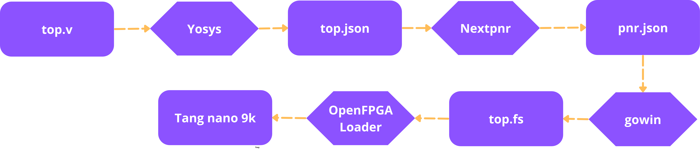


## 1. Entorno

```bash
source ~/oss-cad/oss-cad-suite/environment
cd ~/Escritorio/tesla/Yosys_fpga/blink
yosys
```

Yosys debe abrirse dentro de `blink/`, si no, no encuentra `top.v`.

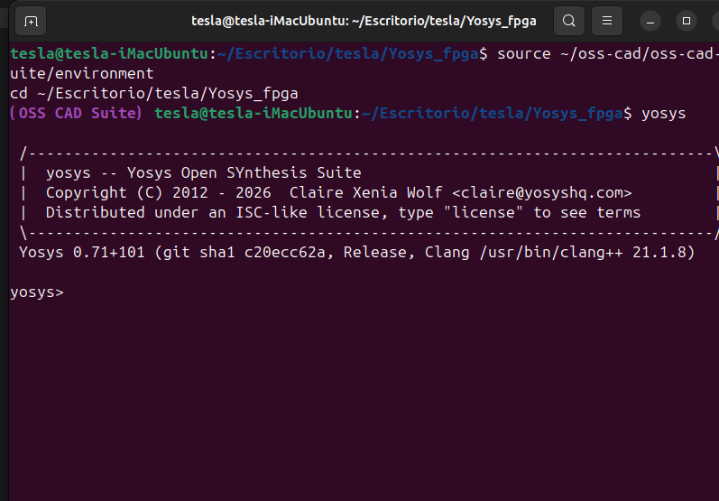

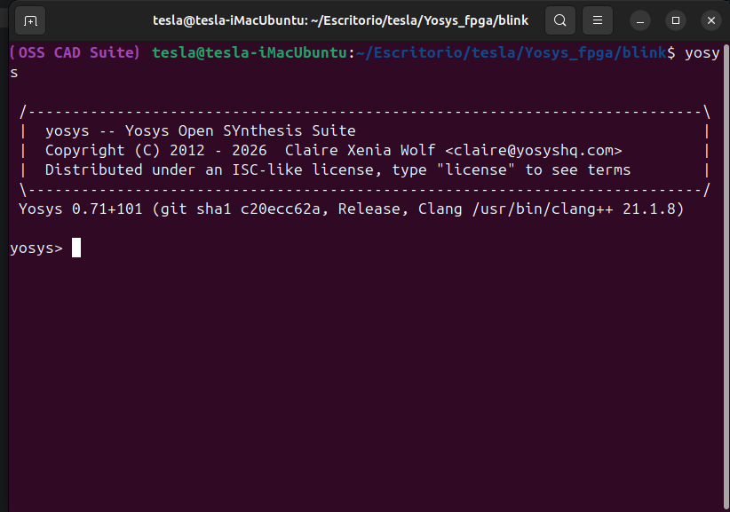

## 2. Síntesis con Yosys

Dentro del shell de Yosys, un comando a la vez.

```
read_verilog top.v
hierarchy -check -top top
proc
opt
synth_gowin -top top -json top.json
stat
```

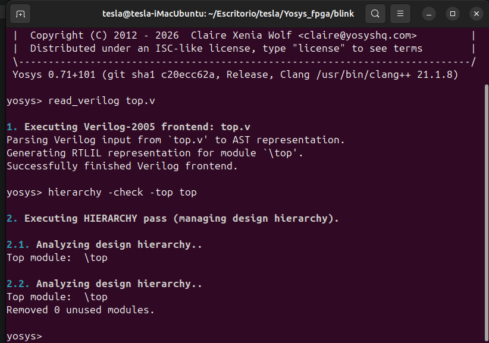

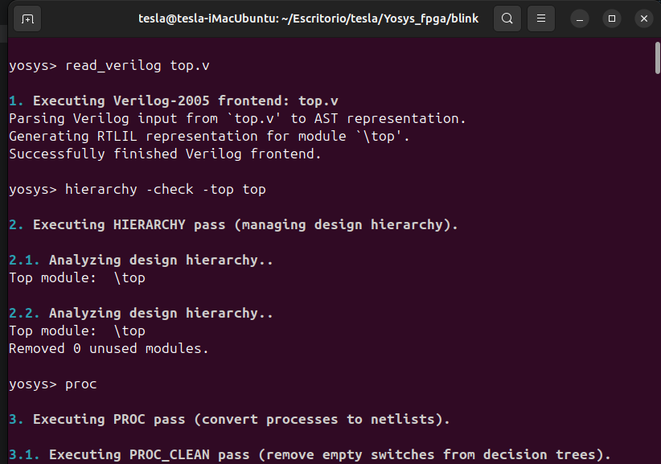

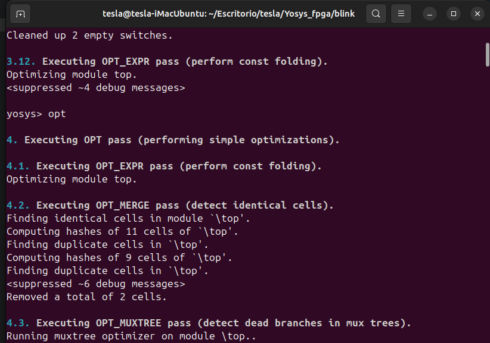

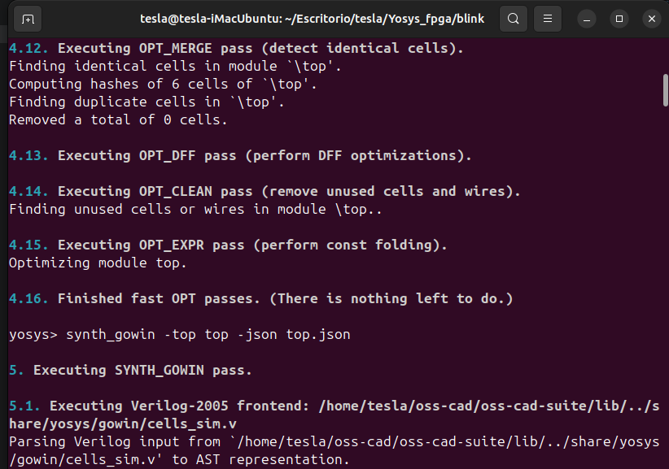

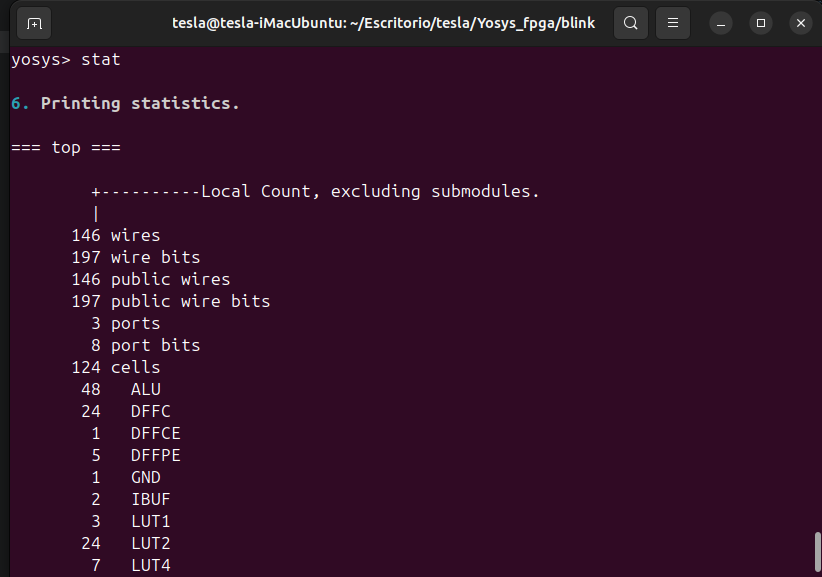

## 3. Place and route

Necesitas `top.cst` con los pines. Luego, en la terminal normal.

```bash
nextpnr-himbaechel --json top.json --write pnr.json \
  --device GW1NR-LV9QN88PC6/I5 \
  --vopt family=GW1N-9C \
  --vopt cst=top.cst \
  --freq 27
```

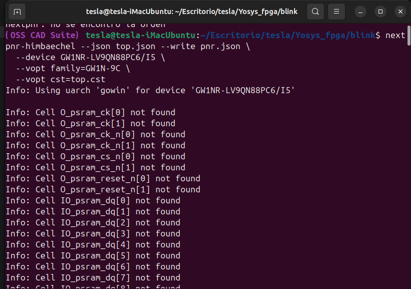

Resultado obtenido, frecuencia máxima de 142,82 MHz.

## 4. Empaquetado

```bash
gowin_pack -d GW1N-9C -o top.fs pnr.json
```

Los avisos de Numpy, Msgspec y fastcrc son inofensivos.

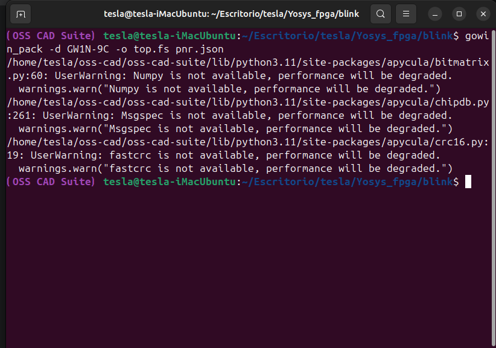

## 5. Carga

A SRAM, volátil.

```bash
openFPGALoader -b tangnano9k top.fs
```

A flash, persistente.

```bash
openFPGALoader -b tangnano9k -f top.fs
```

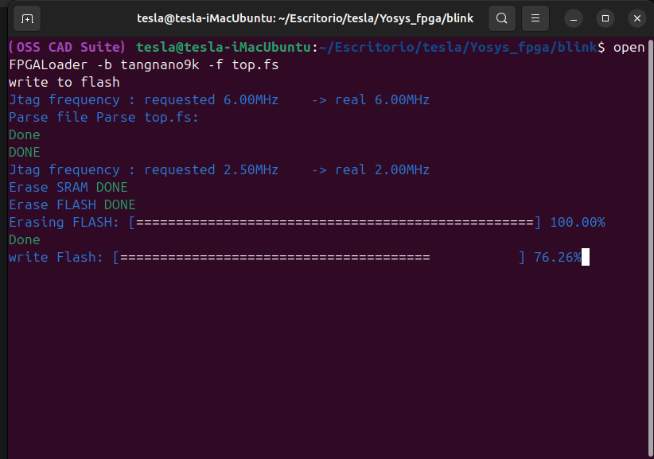

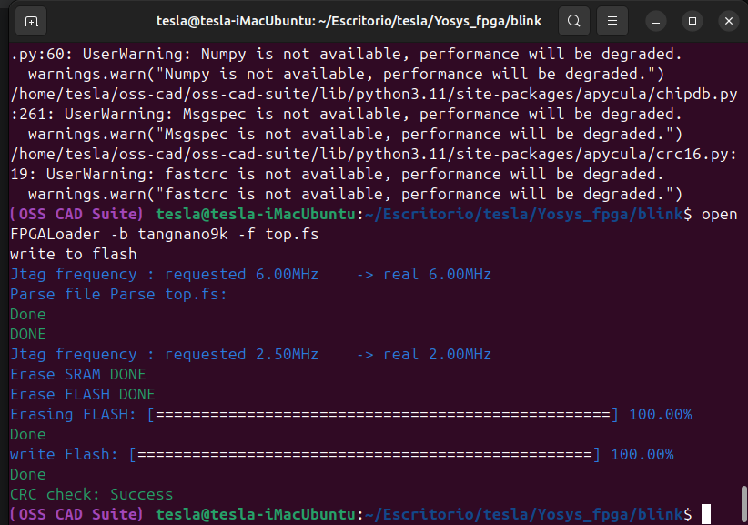
